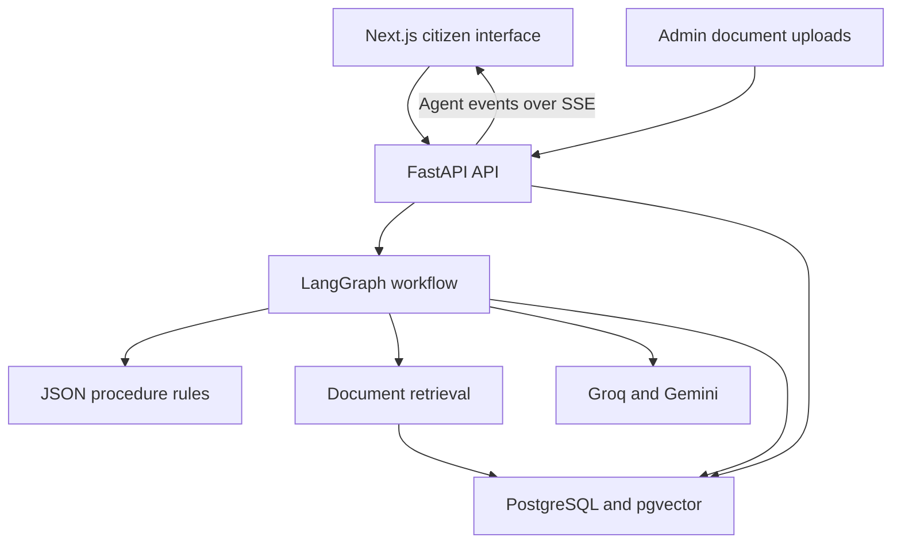

# HelpLK AI
### Government procedures, guided step by step.

**HelpLK AI is a citizen-services copilot for Sri Lanka, built by Team 29 — Teal Titans for AGENTRIX26.** A citizen describes a goal, and the application turns it into an ordered plan with requirements, eligibility questions, source references, and progress tracking.

> **Example:** “I lost my NIC and need to apply for a passport.”
>
> The application identifies the missing identity document, plans the prerequisite process, and tracks the steps needed before the citizen can continue.

This repository contains a **hackathon prototype**. It helps users prepare and track a procedure; it does not submit applications to government departments.

## At a glance

| Question | Answer |
| --- | --- |
| What problem does it address? | Government-service instructions are scattered, and citizens may not know which documents or prerequisite steps they need. |
| What does the user get? | A saved case with an actionable workflow, requirements, explanations, and progress. |
| What makes it more than a chat interface? | A stateful agent workflow combines language-model planning with explicit rules, dependency checks, and persistent case data. |
| Who is it for? | Sri Lankan citizens navigating documentation and public-service procedures. |
| Where should a reviewer start? | Follow the demo below, then read the architecture and code-tour sections. |

## A quick demo for reviewers

1. Open the application and sign in with a **demo email address**.
2. Enter **“I lost my NIC and need to apply for a passport.”**
3. Watch the processing view receive agent events from the backend.
4. Answer eligibility questions when prompted.
5. Inspect the generated steps, their prerequisites, and available source citations.
6. Open the requirements list. Use **“I have it”** to confirm an item or **“How to get it?”** to create a linked sub-goal for a missing requirement.
7. Mark completed steps and return to the dashboard to see the saved case and updated progress.
8. Switch between English, Sinhala, and Tamil to explore the multilingual experience.

The current citizen interface uses **requirement confirmation and sub-goals**, rather than requiring citizens to upload identity documents. Document-analysis APIs remain in the backend; administrator uploads are used to build the knowledge base.

## Main capabilities

- **Goal-based planning:** identifies relevant services from natural-language input, with a keyword fallback for known procedures.
- **Dependency-aware workflows:** orders prerequisites and locks steps whose requirements are not yet satisfied.
- **Interactive eligibility checks:** asks for missing information and supports resuming a checkpointed workflow.
- **Persistent cases:** stores steps, requirements, sub-goals, progress, and agent logs.
- **Hybrid knowledge retrieval:** combines structured procedure rules with relevant passages from an indexed document corpus.
- **Source-aware explanations:** exposes citations where available; custom plans can include steps without retrieved evidence.
- **Multilingual interaction:** English, Sinhala, and Tamil interface strings, input normalization, and response translation.
- **Voice input:** browser speech recognition where available, with a backend transcription fallback.
- **Admin knowledge management:** upload, index, reindex, delete, and test retrieval from reference documents.

### Included procedure coverage

The repository includes structured JSON workflows for:

| Procedure | Rule file |
| --- | --- |
| Passport application | [passport_application.json](backend/data/procedures/passport_application.json) |
| Duplicate NIC | [duplicate_nic.json](backend/data/procedures/duplicate_nic.json) |
| Driving licence renewal | [driving_license_renewal.json](backend/data/procedures/driving_license_renewal.json) |
| Birth certificate copy | [birth_certificate_copy.json](backend/data/procedures/birth_certificate_copy.json) |

Other goals can use model-generated custom plans when Groq is configured. These do not have the same predefined rule coverage.

## How it works



**The workflow:** the planner identifies services; the knowledge node retrieves requirements and sources; dependency and eligibility nodes determine what can proceed; the checklist node produces actionable steps. When more eligibility information is needed, the graph can pause and resume with the user's answers.

**Two kinds of state:** database tables hold the user-facing case, while PostgreSQL-backed LangGraph checkpoints retain execution state. A case ID identifies its workflow thread. Without an available checkpointer, the runner falls back to execution without resumable pauses.

**RAG, in plain language:** retrieval-augmented generation means looking up relevant reference text before generating guidance. Here, JSON rules handle known dependencies and eligibility, while vector search retrieves supporting document passages.

### Technical decisions worth discussing

| Decision | Why it matters |
| --- | --- |
| Rules alongside language models | Known prerequisites can be checked explicitly instead of relying entirely on generated text. |
| Server-Sent Events (SSE) | The browser receives workflow updates over one streaming HTTP response. |
| Separate case data and execution checkpoints | User progress and paused agent execution have distinct responsibilities. |
| English canonical workflow state | Translation happens at the boundaries, so changing display language does not rewrite completed steps or machine-readable eligibility values. |
| Embedding-model tracking | Retrieval filters by the model that created each vector, avoiding comparisons between incompatible embedding spaces. |
| Citation URL filtering | When retrieved passages provide source URLs, custom-plan URLs are checked against those sources. This reduces invented links but does not guarantee factual correctness. |

## Technology stack

| Layer | Implementation |
| --- | --- |
| Web interface | Next.js 16, React 19, TypeScript, Tailwind CSS 4, Framer Motion |
| API | Python, FastAPI, Pydantic |
| Agent orchestration | LangGraph |
| Persistence | SQLAlchemy, PostgreSQL, Alembic |
| Vector retrieval | Direct pgvector integration |
| AI services | Groq for planning and language tasks; Gemini for embeddings and audio/vision paths |
| Local fallbacks | Sentence Transformers for embeddings; Tesseract for OCR |
| Authentication | Demo email-to-JWT flow using HS256 |
| Deployment | Docker Compose, with an external PostgreSQL database |
| Tests | pytest; frontend lint and build scripts |

The current implementation uses direct pgvector access and demo JWT authentication. References to LlamaIndex or NextAuth in earlier planning documents describe earlier design intentions.

## Run locally with Docker

### Prerequisites

- Git and Docker with Docker Compose.
- An accessible **PostgreSQL database with pgvector**. The Compose file does not start a database service.
- A database user allowed to create the required tables and enable the `vector` extension, or a database where the extension is already enabled.
- Groq and Gemini API keys for the fuller AI experience. Some known-procedure paths have fallbacks, but keyless mode is not feature-equivalent.

### 1. Clone and configure

```bash
git clone https://github.com/Agentrix-ComES/AGENTRIX26-TEAM29-Teal_Titans.git
cd AGENTRIX26-TEAM29-Teal_Titans
cp .env.example .env
```

Edit the root `.env`:

```dotenv
DATABASE_URL=postgresql+psycopg://USER:PASSWORD@DB_HOST:5432/DB_NAME
AUTH_SECRET=replace-with-a-long-random-secret
NEXT_PUBLIC_BACKEND_URL=http://localhost:8000
FRONTEND_ORIGIN=http://localhost:3000
ADMIN_EMAILS=
GROQ_API_KEY=
GEMINI_API_KEY=
```

Use a database hostname reachable **from inside the backend container**. Inside that container, `localhost` refers to the container itself.

For an admin demo, set `ADMIN_EMAILS` to your chosen demo email. Keep real credentials out of Git.

### 2. Build and start

```bash
docker compose up --build -d
docker compose logs -f backend
```

The backend entrypoint waits for the database, initializes tables and pgvector, and runs Alembic migrations.

### 3. Index the bundled reference corpus

Once the backend is running:

```bash
docker compose exec backend python -m app.rag.ingest
```

This populates the retrieval index from `backend/data/corpus/`. Without a Gemini key, the embedding fallback may download a local model on first use.

### 4. Open the application

| Service | Local address |
| --- | --- |
| Citizen interface | http://localhost:3000 |
| Interactive API documentation | http://localhost:8000/docs |
| API health endpoint | http://localhost:8000/health |
| Admin knowledge interface | http://localhost:3000/admin |

Sign in using the same email on later visits to access the same demo identity.

**Configuration notes**

- `NEXT_PUBLIC_BACKEND_URL` must be reachable by the browser and the frontend server. It is baked into the frontend build; rebuild after changing it.
- `FRONTEND_ORIGIN` must match the browser's frontend origin for CORS.
- Reindex the corpus and uploaded knowledge documents when changing embedding models.
- The code has a SQLite development fallback, but PostgreSQL is the intended route for vector retrieval and durable workflow checkpoints.

For development outside Docker, see the [backend setup guide](backend/README.md). The frontend uses `npm ci` followed by `npm run dev`, with `NEXT_PUBLIC_BACKEND_URL=http://localhost:8000` in `frontend/.env.local`.

## Code tour

| Path | What to inspect |
| --- | --- |
| [frontend/app/](frontend/app/) | Landing, sign-in, goal, processing, case, dashboard, and admin pages |
| [frontend/lib/api.ts](frontend/lib/api.ts) | API calls, JWT handling, language headers, and SSE consumption |
| [backend/app/api/](backend/app/api/) | HTTP endpoints for cases, runs, requirements, documents, forms, and admin operations |
| [backend/app/graph/builder.py](backend/app/graph/builder.py) | Agent graph and conditional eligibility loop |
| [backend/app/graph/runner.py](backend/app/graph/runner.py) | Checkpoint lifecycle and streamed execution |
| [backend/app/graph/nodes/](backend/app/graph/nodes/) | Individual planning, knowledge, dependency, and workflow responsibilities |
| [backend/app/rag/](backend/app/rag/) | Extraction, chunking, ingestion, retrieval, and rule loading |
| [backend/app/i18n/](backend/app/i18n/) | Input normalization, translation, glossary, and localization |
| [backend/app/db/](backend/app/db/) | Data models, sessions, and migrations |
| [backend/tests/](backend/tests/) | Tests for auth, workflows, retrieval, requirements, multilingual behavior, and voice |

## Validation commands

With Python 3.11 and the backend requirements installed:

```bash
cd backend
pytest
```

With Node.js 20.9+ and npm installed, from a separate terminal at the repository root:

```bash
cd frontend
npm ci
npm run lint
npm run build
```

These are the repository's available validation commands; this README does not claim a measured coverage percentage or a fresh passing test run.

## Prototype boundaries and next steps

- **Authentication is for demonstrations.** The token endpoint accepts an email without verifying ownership. JWT checks and per-user queries do not make this production identity verification; an allowlisted email can also obtain the demo admin role. Replace this flow before exposing sensitive data.
- **No government transactions are performed.** Application submission, official identity verification, payments, and appointment booking are not integrated.
- **Guidance depends on source quality and model output.** The bundled corpus is not automatically guaranteed current, and custom plans can fall back to model knowledge. Review unsupported guidance against official sources.
- **Reminders are workflow-derived suggestions.** External SMS, WhatsApp, or email delivery is not implemented.
- **Some backend capabilities are separate from the main UI.** Document analysis and form-assistance endpoints exist; the form node itself is a pass-through in the graph.
- **Production work remains:** verified authentication, reviewed and maintained source data, operational monitoring, and durable background ingestion jobs.

## Further reading

- [Backend implementation and setup](backend/README.md)
- [Original implementation plan](IMPLEMENTATION_PLAN.md)
- [Project structure and ownership plan](PROJECT_STRUCTURE.md)
- [Deployment guide](deploy.md)
- [Team module briefs](backend/docs/team/)

The planning documents provide project history and intended responsibilities; the current source code is the reference for implemented behavior.

